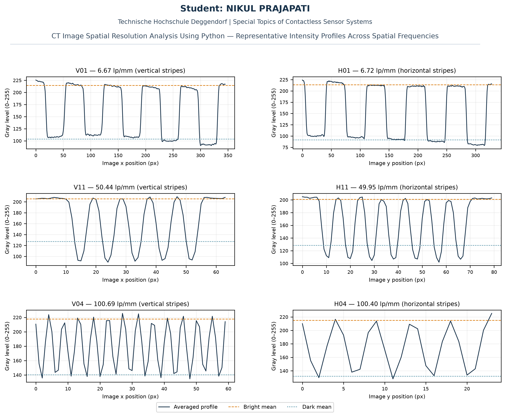
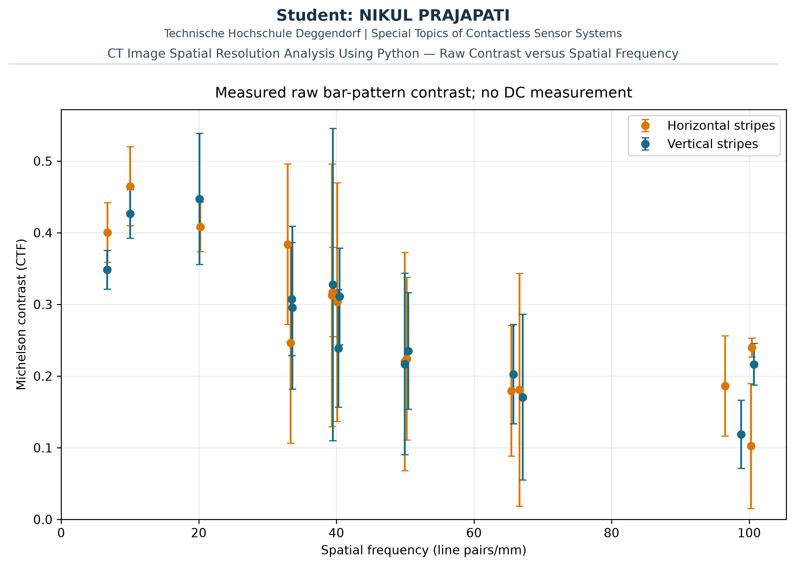
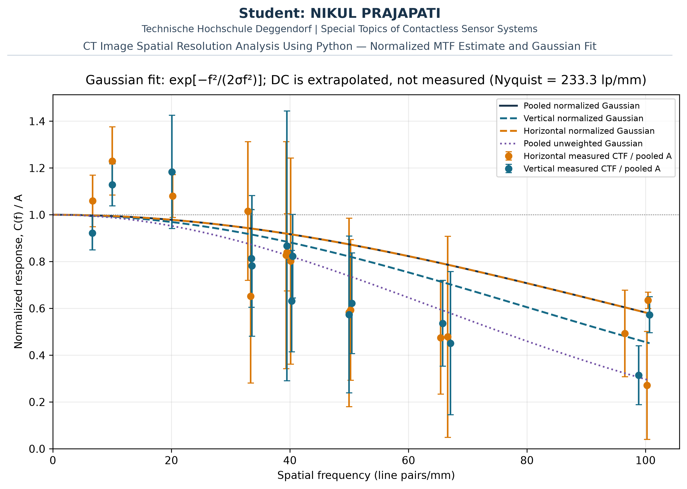

# CT Image Spatial Resolution Analysis Using Python

**Nikul Prajapati** · Technische Hochschule Deggendorf (THD)<br>
**Course:** Special Topics of Contactless Sensor Systems

## Project Overview

This project analyzes spatial resolution from periodic black-and-white bar
patterns in a CT test image. It measures stripe periods and Michelson contrast,
then compares weighted and unweighted Gaussian fits to the measured response.

The analysis was tested on the supplied 1301 × 1301 image at a pixel pitch of
**2.143 µm**. The original CT image and the image-containing ROI overview are
not included: redistribution permission could not be established. The report
PDF and carousel include derived analysis figures and measurements but do not
reproduce the original CT image.

## Technologies

Python, NumPy, OpenCV, SciPy, Matplotlib, Pandas, Pillow, windowed FFT
period estimation, nonlinear Gaussian fitting.

## Methodology

1. Read the original grayscale PNG and validate its dimensions.
2. Select editable regions of interest (ROIs) containing periodic stripe bars.
3. Average parallel scan lines and extract grayscale profiles perpendicular
   to the stripes.
4. Measure bright and dark stripe-interior intensities and calculate
   Michelson contrast:
   `C = (Ibright − Idark) / (Ibright + Idark)`.
5. Estimate the complete bright-plus-dark period from the profile and convert
   it to spatial frequency using the 2.143 µm pixel pitch:
   `Period_mm = Period_px × 0.002143 mm/px` and `f = 1 / Period_mm`.
6. Plot measured bar contrast against spatial frequency.
7. Normalize the fitted response to its extrapolated zero-frequency
   amplitude, `A`; DC is not directly measured by a nonzero-frequency ROI.
8. Fit `C(f) = A exp[−f² / (2σf²)]` and report σf in lp/mm.

The measured bar-pattern contrast is a **contrast transfer function (CTF)**.
The normalized Gaussian is an **MTF approximation**, not a fully corrected
sinusoidal MTF: no square-wave harmonic conversion was applied. Normalized
measurements can exceed 1 when an individual CTF measurement is higher than
the fitted extrapolated amplitude `A`. This does not indicate physical MTF
above unity.

## Results

There are **29 usable ROIs from 31 candidates**. The measured frequency range
is **6.67–100.69 lp/mm**.

| Pooled fit | A (extrapolated DC) | σf (lp/mm) | R² | RMSE |
|---|---:|---:|---:|---:|
| Weighted | 0.3778 ± 0.0064 | **96.16 ± 2.63** | 0.313 | 0.0788 |
| Unweighted | 0.3767 ± 0.0187 | **64.17 ± 5.41** | 0.657 | 0.0557 |

σf is the frequency-domain standard deviation. The weighted and unweighted
widths differ by 31.98 lp/mm (33.3% relative to the weighted estimate). The
weighted fit has weak agreement with the data, while the unweighted fit has
only moderate agreement. Neither width is a definitive scanner-resolution
measurement. Formal fit errors do not include systematic ROI placement,
pixel-pitch, or CTF-to-MTF uncertainty.

## Measured Results

### Representative intensity profiles



[View profiles from all usable ROIs](results/intensity_profiles.png).

### Raw bar-pattern contrast (CTF)



### Normalized MTF estimate and Gaussian fits



## Reports and Presentation

- [Scientific report (PDF)](CT_Image_Spatial_Resolution_Analysis_Report.pdf)
- [LinkedIn carousel (PDF)](CT_Image_Spatial_Resolution_Analysis_LinkedIn_Carousel.pdf)
- [Detailed Markdown results](results/report.md)
- [Measured ROI values](results/measurements.csv)
- [Gaussian fit parameters](results/fit_results.csv)

The published PDF and carousel do not contain the source CT image or its ROI
overview. The detailed analysis code can generate a local ROI overview when
run with an authorized input image.

## Reproducibility

Use Python 3.14 or newer:

```bash
python3.14 -m venv .venv
source .venv/bin/activate
python -m pip install -r requirements.txt
```

In Windows PowerShell, activate with `.venv\Scripts\Activate.ps1`.

The source image is intentionally not distributed. To reproduce the analysis,
use an image you are authorized to process and place it in the project root as
`Horizontal_QRM_Micro_tomolibri (2).png` or
`Horizontal_QRM_Micro_tomolibri.png`. The script expects a 1301 × 1301 image;
for a different target layout, inspect and edit `EXPECTED_SHAPE` and the
half-open pixel coordinates in `ROI_CONFIG` before interpreting its results.

Run the analysis and then generate the carousel:

```bash
python mtf_analysis.py
python create_linkedin_carousel.py
```

The analysis script writes measurements, fit results, figures, a Markdown
report, an ROI overview, and an image-free PDF report. The generated ROI
overview is ignored by Git because it embeds the input image. The carousel
uses only the generated plot figures and numerical results.

## Development and AI Assistance

I reviewed the project requirements, supplied the input image, defined the
analysis requirements, and reviewed the outputs. GitHub Copilot assisted with
the Python implementation, numerical calculations, plotting, and
documentation. The project was tested using the original supplied image.
